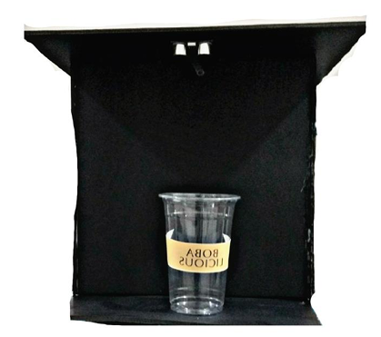
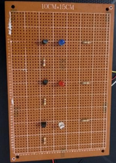

# Automatic Contactless Juice Dispenser (Arduino & Discrete Electronics)

-00979D)

-lightgrey)

> **A physical contactless beverage dispensing prototype combining Arduino-based ultrasonic cup detection and relay pump control with an independent, transistor-based tank level monitoring circuit.**

---

## 📄 Code & Full Documentation
- 💻 **[View Arduino Firmware (`src/juice_dispenser.ino`)](src/juice_dispenser.ino)**
- 📑 **[View / Download Full Project Report (PDF — Arabic)](docs/Automatic_Juice_Dispenser_Report_AR.pdf)**

---

## 🎯 Project Overview
Manual beverage dispensing suffers from inconsistent portions, liquid waste, and hygiene concerns from direct physical contact. This project implements a complete **physical hardware prototype** of an automated juice dispenser featuring a **dual-circuit architecture**:
1. **Automated Dispensing Subsystem (Arduino Uno):** Detects cup placement via an `HC-SR04` ultrasonic sensor and triggers a `12V` food-grade pump through an electrically isolated `5V` relay module.
2. **Independent Liquid Level Monitor (Discrete Electronics):** A standalone soldered perfboard circuit using NPN transistors and 3-stage LEDs that monitors reservoir levels (`100%`, `50%`, `25%`) without consuming microcontroller I/O pins or adding software overhead.

- **Institution:** Saba University — Faculty of Engineering (Mechatronics Engineering)
- **Author & Sole Developer:** Afnan Aref
- **Supervision:** Eng. Zohoor Al-Shajara

---

## ⚙️ Hardware Architecture & Specifications
| Subsystem / Component | Specification | Function |
| :--- | :--- | :--- |
| **Microcontroller** | Arduino Uno (`ATmega328P`, 16 MHz) | Reads ultrasonic sensor & controls pump relay |
| **Cup Detection Sensor** | `HC-SR04` Ultrasonic (2–400 cm, 3 mm res.) | Contactless cup detection (`TRIG → D5`, `ECHO → D4`) |
| **Switching Stage** | 1-Channel `5V` Relay Module (`10A`) | Electrically isolates Arduino from the pump (`IN → D6`) |
| **Actuator** | `12V` DC Pump (1–3 L/min, food-grade) | Transfers juice from reservoir to cup |
| **Level Monitor Circuit** | 3× NPN Transistors (`2N2222`/`BC547`), `220 Ω` & `1 kΩ` Resistors, 3× LEDs | Standalone hardware indicator for `100%` (Green), `50%` (Yellow), and `25%` (Red) tank levels |
| **Power & Enclosure** | `9V` DC Supply + Custom Black Enclosure | Protects electronics and houses nozzle/sensor assembly |

---

## 🔧 Standalone Level-Sensing Circuit (Soldered Hardware)
To improve system reliability and reduce microcontroller load, the tank level monitoring stage was built on a dedicated `10 cm × 15 cm` perfboard using discrete NPN transistor switching:

- **100% Full:** Top probe triggers transistor → **Green LED ON**
- **50% Half:** Mid probe active → **Yellow LED ON**
- **25% Low:** Bottom probe active → **Red LED ON**
- **< 25% Empty:** All LEDs OFF → signals refill required

---

## 📌 Note on Documentation Language
*While the complete 31-page academic project report in `docs/` is written in Arabic, this README and the source code in `src/` provide full English technical documentation of the hardware architecture, firmware logic, and physical implementation.*
